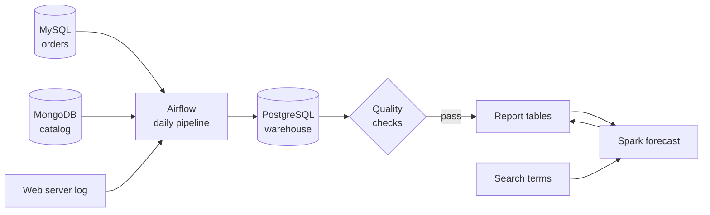

# CartPulse

CartPulse is a portfolio data engineering project. It is a reproducible batch pipeline that turns e-commerce orders into checked sales reports and a 12-month forecast.

It is not a live store. It runs on one machine with sample data, and `make next-day` simulates each new business day, so every result can be reproduced with one command.

[](https://github.com/bunyamin-polat/cart-pulse/actions/workflows/ci.yml)
[](https://github.com/bunyamin-polat/cart-pulse/actions/workflows/integration.yml)


## Purpose

Imagine an online store. Orders live in MySQL, the product catalog in MongoDB and site traffic in web server logs. On Monday morning, the head of sales asks an analyst three questions:

- Which categories drive revenue in Germany?
- What should we expect to sell over the next 12 months?
- What are customers searching for?

Answering from the live order database creates two problems. Heavy reports compete with customers placing orders, and nothing proves that the numbers are complete.

CartPulse solves both. Every day, it copies the data into a separate warehouse, checks it, and publishes reports only if every check passes. The store and this scenario are simulated, and the pipeline behind them is real and tested.

### What the quality gate protects

Suppose a faulty load leaves 200 orders for Germany out of the warehouse:

| | Without a quality gate | With CartPulse |
| --- | --- | --- |
| **The run** | The incomplete data is published | The check fails and publishing stops |
| **The analyst sees** | Germany looks weaker than it really is | The last correct reports |
| **The outcome** | A decision rests on a wrong number | The failed run is visible in Airflow, ready to fix and rerun |

This is why every order is compared with the source. Comparing totals alone is not enough, because one order that is too high and another that is too low by the same amount leave the total unchanged.

The forecast follows the same rule. A trend model is published only if it clearly beats a plain monthly average on a year it has not seen. On this sample data it does not, so CartPulse publishes the average and names it in the output.

## What happens, step by step



1. **The sources are filled.** `make seed` loads 291,525 orders into MySQL and 438 products into MongoDB. December 2021 is held back to act as future orders.
2. **A business day is simulated.** `make next-day` adds the next day of held-back orders and cancels five of them, as a real store would.
3. **Orders load incrementally.** The pipeline reads only orders whose `updated_at` is recent and writes them to the warehouse. It saves its position in the same transaction, so a failed run leaves nothing half done.
4. **Catalog and web traffic refresh.** Products come from MongoDB and requests are parsed from the web server log. Both replace their previous copy in one transaction.
5. **The star schema is built.** Staging data becomes one fact table and three dimensions. The calendar is generated from the dates, so its labels cannot be wrong.
6. **Quality checks run.** Every order is compared with MySQL, and the catalog and log counts are compared with their sources. If any check fails, the run stops here.
7. **Reports are published.** The report tables refresh in one transaction, and cancelled orders are left out of revenue. If step 6 failed, analysts keep the last good reports.
8. **Spark adds the forecast.** On demand, Spark reads monthly sales from the warehouse, tests a trend against a plain average on a year it has not seen, and publishes the winner.

Airflow runs steps 3 to 7 every day, and `make pipeline` runs the same code by hand. See the [architecture](docs/architecture.md) for the full design.

## Quick start

Requires [Docker](https://docs.docker.com/get-docker/), [uv](https://docs.astral.sh/uv/) and `make`. On Linux, MongoDB does not start on kernels 6.19 to 7.0.13. See [operations](docs/operations.md#mongodb-does-not-start).

```bash
git clone https://github.com/bunyamin-polat/cart-pulse.git
cd cart-pulse
make setup
```

Replace the placeholder passwords in `.env`, then run steps 1 to 7:

```bash
make demo
```

Continue with the rest of the platform:

```bash
make forecast       # publish the 12-month forecast
make search-terms   # publish the search term ranking
make airflow        # start the scheduler at http://127.0.0.1:8088
make next-day       # simulate another business day
make psql           # query the warehouse
```

Run `make` to list every command.

## Sample results

These outputs come from a run on an empty system. Yours will match, except for timestamps.

The first load moves every order, and each simulated day then moves only what changed:

```text
Seeded 291525 orders up to 2021-11-30
Orders: 291525 read, 291525 changed
Added 269 orders for 2021-12-01 and cancelled 5
Orders: 291794 read, 269 changed
Quality checks passed
```

The second load reads more rows than it changes because seeding happened moments earlier, inside the five-minute lookback window. On a normal schedule it reads little more than the new rows.

`make report` prints the published sales:

```text
   year    |  total_sales
-----------+---------------
 2019      |  399729036.00
 2020      |  400441641.00
 2021      |  367690953.00
 All years | 1167861630.00
```

2021 is lower because December is mostly held back.

`make forecast` tests both models and publishes the plain average, because the trend does not clearly beat it:

```text
Backtest RMSE, linear trend: 1,012,168
Backtest RMSE, average month: 1,015,064
Published model: average_month
Forecast for the next 12 months: 400,051,699
```

The report tables are in the warehouse's `marts` schema:

| Table | Answers |
| --- | --- |
| `sales_by_year_country` | Total sales per year per country |
| `sales_by_month_category` | Total sales per month per category |
| `sales_by_quarter_country` | Total sales per quarter per country |
| `sales_by_category_country` | Total sales per category per country |
| `monthly_sales` | Monthly sales, with incomplete months marked |
| `sales_forecast` | The next 12 months, with the model used and its error |
| `top_search_terms` | How often each term is searched |
| `catalog_summary` | Products and average screen size per product type |
| `web_traffic_daily` | Daily requests, visitors and server errors |

## Key engineering decisions

| Decision | Why it matters |
| --- | --- |
| Watermark on `updated_at` with a lookback | Finds corrections and cancellations as well as new orders, and tolerates transactions that commit slightly late |
| Rows and watermark in one transaction | A failure leaves no partial load, and the next run retries safely |
| Quality gate before publishing | Bad data stops at the warehouse, and analysts keep the last good reports |
| Order-by-order reconciliation | Row counts and totals can hide a changed amount or changes that cancel out |
| Generated calendar | The sample data's date labels disagree with the calendar on hundreds of days, so the pipeline does not use them |
| Baseline for the forecast | A trend is published only if it beats a plain average by at least 5% on an unseen year. Here it does not, and the output says so |
| Isolated end-to-end tests | They run in a temporary stack with their own volumes, so they cannot touch local data |

The [architecture guide](docs/architecture.md) explains each decision and its trade-offs.

## Scope

CartPulse is a batch pipeline that imitates production concerns. These boundaries are deliberate:

- **Simulated data.** The orders are synthetic sales from 2019 to 2021, and sales in this data have no useful trend.
- **Sales, catalog and traffic stay separate.** The sample datasets share no product or customer ID. Joining them would mean inventing a link, so each answers its own questions.
- **SQL is the interface.** There is no dashboard, and the report tables are ready for any SQL client or BI tool.
- **One machine.** Everything runs on Docker Compose with ports bound to localhost. Current images report upstream vulnerabilities, so do not expose it to a network.
- **The forecast runs on demand.** It is not part of the daily Airflow run, because Spark needs its own container.
- **Late commits have a limit.** A change that commits more than five minutes after its timestamp is missed by the regular load. Reconciliation reports it, and a longer lookback repairs it.
- **Orders are cancelled, not deleted.** Hard deletes in the source are not handled.

## Project structure

```text
.
├── cartpulse/       Pipeline code: loads, quality checks and sample data
├── orchestration/   Airflow image and the daily DAG
├── spark/           Spark image and analytics jobs
├── sql/             Source schema, warehouse layers and reports
├── scripts/         Data download, backup and test scripts
├── tests/           Unit and end-to-end tests
└── docs/            Architecture and operations guides
```

## Development

```bash
make lint               # check imports and formatting
make format             # apply fixes
make test               # run the unit tests
make test-integration   # run the end-to-end tests in a temporary stack
```

CI runs linting, shell checks, Compose validation and unit tests on every push. The integration workflow runs the full platform weekly and on demand. See the [operations guide](docs/operations.md) for running and recovering the platform.

## Acknowledgment

The sample data is downloaded from the [IBM Data Engineering Professional Certificate](https://www.coursera.org/professional-certificates/ibm-data-engineer) and is not part of this repository. CartPulse began as that program's capstone.

## License

The code is released under the [MIT](LICENSE) license.
