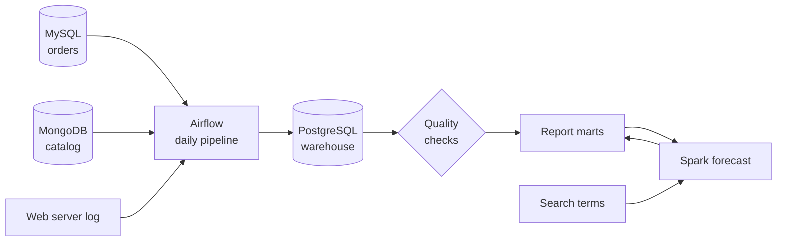

# CartPulse

CartPulse is a portfolio project that shows how an e-commerce data platform fits together. It moves orders, catalog data and web traffic into a tested sales warehouse, and publishes reports and a 12-month forecast that analysts can query.

It runs on one machine with sample data, so it demonstrates production patterns without being production software. See [Limitations](#limitations).

[](https://github.com/bunyamin-polat/cart-pulse/actions/workflows/ci.yml)
[](https://github.com/bunyamin-polat/cart-pulse/actions/workflows/integration.yml)


## What it answers

The platform is designed around an analyst who needs sales numbers they can trust, without touching the live store database.

- What did we sell per year, quarter and month, by country and category?
- Which sales were cancelled, and are they out of the revenue figures?
- What should we expect to sell over the next 12 months?
- What do customers search for, and how much traffic does the store get?

## How it works



Every day, Airflow loads new and changed orders, refreshes the catalog and web traffic, rebuilds the star schema and runs the quality checks. The reports are published only if every check passes. See the [architecture](docs/architecture.md) for the design decisions.

## Quick start

Requires [Docker](https://docs.docker.com/get-docker/), [uv](https://docs.astral.sh/uv/) and `make`. On Linux, MongoDB does not start on kernels 6.19 to 7.0.13. See [operations](docs/operations.md#mongodb-does-not-start).

```bash
git clone https://github.com/bunyamin-polat/cart-pulse.git
cd cart-pulse
make setup
```

Replace the placeholder passwords in `.env`, then run the whole flow:

```bash
make demo
```

This starts the databases, loads 291,525 sample orders, replays one new business day and prints the sales reports. Continue with the rest of the platform:

```bash
make forecast       # publish the 12-month sales forecast
make search-terms   # publish the search term ranking
make airflow        # start the scheduler at http://127.0.0.1:8088
make next-day       # add another day of new and cancelled orders
make psql           # query the warehouse
```

Run `make` to list every command.

## What you get

Open a warehouse shell with `make psql` and query the `marts` schema:

| Table | Answers |
| --- | --- |
| `sales_by_year_country` | Total sales per year per country |
| `sales_by_month_category` | Total sales per month per category |
| `sales_by_quarter_country` | Total sales per quarter per country |
| `sales_by_category_country` | Total sales per category per country |
| `monthly_sales` | Monthly sales, with incomplete months marked |
| `sales_forecast` | The next 12 months, with the model used and its error |
| `top_search_terms` | How often each term is searched |
| `catalog_summary` | Products and average screen size per product type |
| `web_traffic_daily` | Daily requests, visitors and server errors |

## Why the numbers can be trusted

- **Orders load incrementally.** The pipeline reads orders by `updated_at`, so new orders and corrections arrive, and a repeat run changes nothing.
- **Loads are atomic.** Rows and the watermark commit together, so a failure leaves no partial load and the next run retries.
- **A failed check stops publication.** Reports keep their last good state until the data passes.
- **The warehouse is reconciled with the source.** Totals are compared per day, country and category, so a missed change or a wrong mapping is caught even when the row count matches.
- **The calendar is generated.** Quarter, month and weekday come from the date itself.
- **Cancelled orders leave revenue.** They stay in the warehouse for audit and are excluded from the reports.
- **The forecast has to earn its place.** A trend is published only if it beats a plain average by at least 5% on a year it has not seen. On the sample data it does not, so CartPulse publishes the average and says so in the `model` column.

## Limitations

- **Sample data.** The orders are synthetic sales from 2019 to 2021, and December 2021 is held back so `make next-day` can replay it. Sales in this data have no useful trend.
- **No dashboard.** The marts are the interface, so a BI tool or SQL client is needed to chart them.
- **Single node.** Everything runs on one machine with Docker Compose, and the ports are bound to localhost. Current images still report upstream vulnerabilities, so do not expose it to a network.
- **Sources are not joined.** Orders carry a category but no product ID, so the catalog and web traffic stand beside the sales data. Web traffic comes from a static log file.
- **Late commits have a limit.** A change that commits more than five minutes after its timestamp is missed by the regular load. Reconciliation detects it, and a longer lookback repairs it.
- **Hard deletes are not handled.** The source is expected to cancel orders, not delete them.

## Project structure

```text
.
├── cartpulse/           Pipeline code: loads, quality checks and sample data
├── orchestration/       Airflow image and the daily DAG
├── spark/               Spark image and analytics jobs
├── sql/                 Source schema, warehouse layers and reports
├── scripts/             Data download and backup
├── tests/               Unit and end-to-end tests
└── docs/                Architecture and operations guides
```

## Development

```bash
make lint               # check imports and formatting
make format             # apply fixes
make test               # run the unit tests
make test-integration   # run the end-to-end tests in a temporary stack
```

CI runs linting, shell checks, Compose validation and unit tests on every push. The integration workflow runs the full platform weekly and on demand. The end-to-end tests start their own containers and volumes, so they never touch local data. See the [operations guide](docs/operations.md) for running and recovering the platform.

## Acknowledgment

The sample data is downloaded from the [IBM Data Engineering Professional Certificate](https://www.coursera.org/professional-certificates/ibm-data-engineer) and is not part of this repository. CartPulse began as that program's capstone.

## License

The code is released under the [MIT](LICENSE) license.
