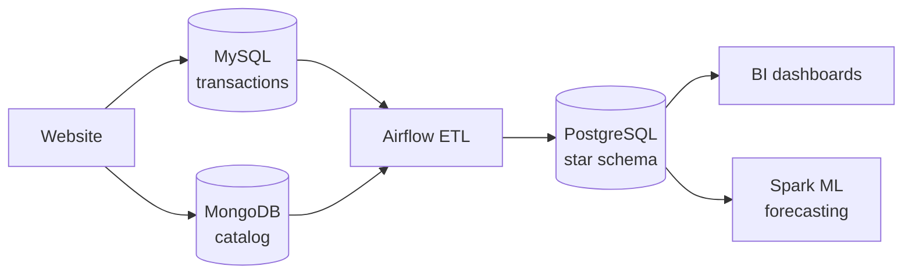

# CartPulse Data Platform

An end-to-end e-commerce data platform that takes retail transactions from an OLTP database to warehouse analytics, dashboards and sales forecasting.


## Architecture



See [docs/architecture.md](docs/architecture.md) for the data flow and design rationale.

## Roadmap

| # | Module | Stack | Status |
| --- | ------ | ----- | ------ |
| 1 | [OLTP database](modules/01-oltp-mysql/README.md) | MySQL | ✅ Done |
| 2 | [NoSQL product catalog](modules/02-nosql-mongodb/README.md) | MongoDB | ✅ Done |
| 3 | Data warehouse and reporting | PostgreSQL | ⏳ Planned |
| 4 | BI dashboard | Looker Studio or Cognos Analytics | ⏳ Planned |
| 5 | ETL pipelines | Python, Airflow | ⏳ Planned |
| 6 | Sales projections | Spark ML | ⏳ Planned |

### Highlights

- MySQL 8.0 runs in Docker Compose with a health check and a non-root user
- A single command loads all 2,605 transactions and 438 catalog documents, and is safe to re-run
- A `ts` index supports time-based incremental exports
- `datadump.sh` backups are verified by restoring every row
- MongoDB stores products with different attributes in one collection
- Setup is tested from a fresh clone

## Quick start

Requires [Docker](https://docs.docker.com/get-docker/), [uv](https://docs.astral.sh/uv/) and `make`.

```bash
git clone https://github.com/bunyamin-polat/cart-pulse.git
cd cart-pulse

make setup   # create the Python environment and .env
```

Replace the placeholder passwords in `.env` before the first start, because each database stores its password when its volume is created.

```bash
make up      # start MySQL and MongoDB and wait until they are healthy
make load    # download the data, create the schemas and load them
make mysql   # open a MySQL shell
make mongo   # open a MongoDB shell
make dump    # export sales_data to a SQL file
```

Run `make` to list every command. `make down` stops the services and keeps the data. `make reset` also deletes the database volume.

## Project structure

```text
.
├── docker-compose.yml      Service definitions
├── Makefile                Common commands
├── pyproject.toml          Python tooling (uv, Ruff)
├── .env.example            Configuration template
├── docs/                   Architecture notes and images
└── modules/
    ├── 01-oltp-mysql/
    │   ├── sql/            Database, schema, load and index statements
    │   ├── scripts/        Data download and dump scripts
    │   └── data/           Downloaded files (git-ignored)
    ├── 02-nosql-mongodb/
    ├── 03-data-warehouse/
    ├── 04-bi-dashboard/
    ├── 05-etl-airflow/
    └── 06-spark-ml/
```

## Development

Python tooling is managed with uv. Ruff handles both import sorting (isort rules) and formatting (Black-compatible).

```bash
make lint     # check without changing files
make format   # apply fixes
```

## Acknowledgment

This project is based on the capstone of the [IBM Data Engineering Professional Certificate](https://www.coursera.org/professional-certificates/ibm-data-engineer). The original lab runs in the IBM Cloud IDE, while this version runs locally with Docker Compose.

## License

[MIT](LICENSE)
