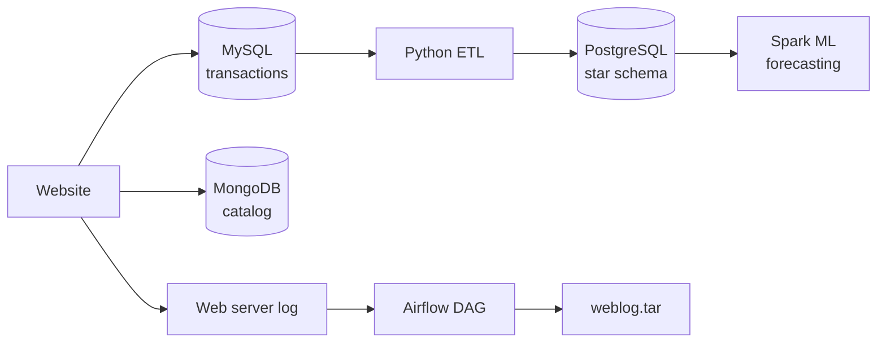

# CartPulse Data Platform

An end-to-end e-commerce data platform that takes retail transactions from an OLTP database to warehouse analytics and sales forecasting.

[](https://github.com/bunyamin-polat/cart-pulse/actions/workflows/ci.yml)


## Architecture



Each module uses the dataset of its course lab, so the modules run independently. See [docs/architecture.md](docs/architecture.md) for the data flow and design rationale.

## Modules

| # | Module | Stack | Status |
| --- | ------ | ----- | ------ |
| 1 | [OLTP database](modules/01-oltp-mysql/README.md) | MySQL | ✅ Done |
| 2 | [NoSQL product catalog](modules/02-nosql-mongodb/README.md) | MongoDB | ✅ Done |
| 3 | [Data warehouse and reporting](modules/03-data-warehouse/README.md) | PostgreSQL | ✅ Done |
| 4 | [ETL pipelines](modules/04-etl-airflow/README.md) | Python, Airflow | ✅ Done |
| 5 | [Sales projections](modules/05-spark-ml/README.md) | Spark ML | ✅ Done |

### Highlights

- MySQL 8.0 runs in Docker Compose with a health check and a non-root user
- A single command loads 2,605 transactions, 438 catalog documents and 300,000 warehouse sales, and is safe to re-run
- A `ts` index supports time-based incremental exports
- `datadump.sh` backups are verified by restoring every row
- MongoDB stores products with different attributes in one collection
- A PostgreSQL star schema answers reports with `GROUPING SETS`, `ROLLUP`, `CUBE` and a materialized view
- A Python ETL copies only new rows, and a second run moves nothing
- An Airflow DAG processes the web server log every day
- Spark jobs analyze search terms and forecast sales, with a backtest against a plain average
- CI runs linting and unit tests on every push, and an integration workflow tests the ETL on real databases

## Quick start

Requires [Docker](https://docs.docker.com/get-docker/), [uv](https://docs.astral.sh/uv/) and `make`.

```bash
git clone https://github.com/bunyamin-polat/cart-pulse.git
cd cart-pulse

make setup   # create the Python environment and .env
```

Replace the placeholder passwords in `.env` before the first start, because each database stores its password when its volume is created.

```bash
make up      # start all databases and wait until they are healthy
make load    # download the data, create the schemas and load them
```

Then try the pipelines:

```bash
make warehouse-reports   # run the warehouse analytics queries
make run-etl             # copy new rows from the ETL source to the warehouse
make airflow             # start Apache Airflow
make spark-build         # build the Spark image
make spark-forecast      # train the sales model and forecast 2023
```

Run `make` to list every command. `make down` stops the services and keeps the data. `make reset` deletes every data volume.

## Project structure

```text
.
├── docker-compose.yml      Service definitions
├── Makefile                Common commands
├── pyproject.toml          Python tooling (uv, Ruff)
├── .env.example            Configuration template
├── .github/workflows/      CI and integration tests
├── docs/                   Architecture notes and images
├── tests/                  Unit tests
└── modules/
    ├── 01-oltp-mysql/
    │   ├── sql/            Database, schema, load and index statements
    │   ├── scripts/        Data download and dump scripts
    │   └── data/           Downloaded files (git-ignored)
    ├── 02-nosql-mongodb/
    ├── 03-data-warehouse/
    ├── 04-etl-airflow/
    └── 05-spark-ml/
```

## Development

Python tooling is managed with uv. Ruff handles both import sorting (isort rules) and formatting (Black-compatible).

```bash
make lint     # check without changing files
make format   # apply fixes
make test     # run the unit tests
```

CI runs linting, shell checks, Compose validation and unit tests on every push. The integration workflow starts real MySQL and PostgreSQL services and runs the ETL twice. It runs weekly and on demand, because it downloads the course data.

## Acknowledgment

This project is based on the capstone of the [IBM Data Engineering Professional Certificate](https://www.coursera.org/professional-certificates/ibm-data-engineer). The original lab runs in the IBM Cloud IDE, while this version runs locally with Docker Compose.

## License

[MIT](LICENSE)
