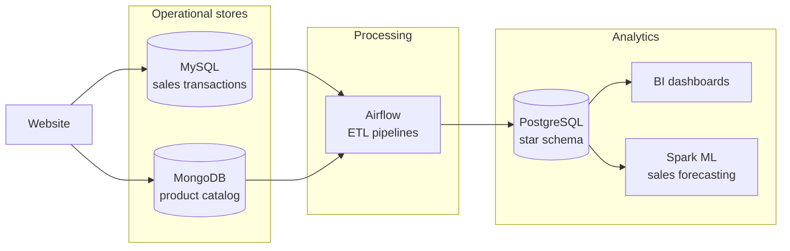

# Architecture

CartPulse moves retail data from operational stores into a warehouse that serves dashboards and sales forecasting.

## Components

| Component | Role | Module | Status |
| --- | --- | --- | --- |
| MySQL | Records sales with low write latency | 1 | ✅ Built |
| MongoDB | Stores the flexible product catalog | 2 | ✅ Built |
| PostgreSQL | Holds fact and dimension tables for reporting | 3 | ✅ Built |
| BI dashboard | Presents retail metrics | 4 | ⏳ Planned |
| Python ETL and Airflow | Copy new sales to the warehouse and process the web log | 5 | ✅ Built |
| Spark ML | Projects future sales | 6 | ⏳ Planned |

## Data flow

1. The website writes transactions to MySQL and reads product data from MongoDB.
2. A Python ETL job copies new sales from MySQL to PostgreSQL, using the highest `rowid` as a high-water mark.
3. Airflow runs a daily pipeline that extracts, filters and archives the web server log.
4. Dashboards and Spark ML read from the warehouse, so analytics never compete with live transactions.

Each module uses the datasets of its course lab, so the flow above shows the target design. The catalog does not feed the warehouse yet, and Airflow does not schedule the Python ETL yet.

## Why separate stores

Each store fits one workload. MySQL handles concurrent writes, MongoDB handles product attributes that vary by category, and PostgreSQL handles analytical queries. Keeping analytics off the OLTP database protects checkout latency.

## Repository conventions

- Each module lives in its own folder under `modules/` with its own README.
- All services are defined in the root `docker-compose.yml`, and optional tools sit behind Compose profiles.
- The root `Makefile` is the single entry point for common tasks.
- Credentials live in a git-ignored `.env` file.
- Setup and load steps are safe to re-run.
- Raw data is downloaded by script and never committed.
