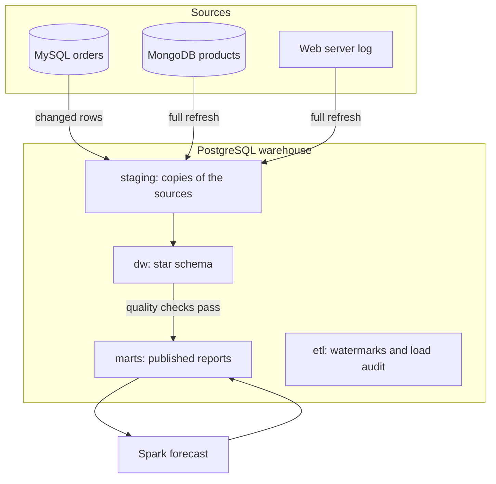
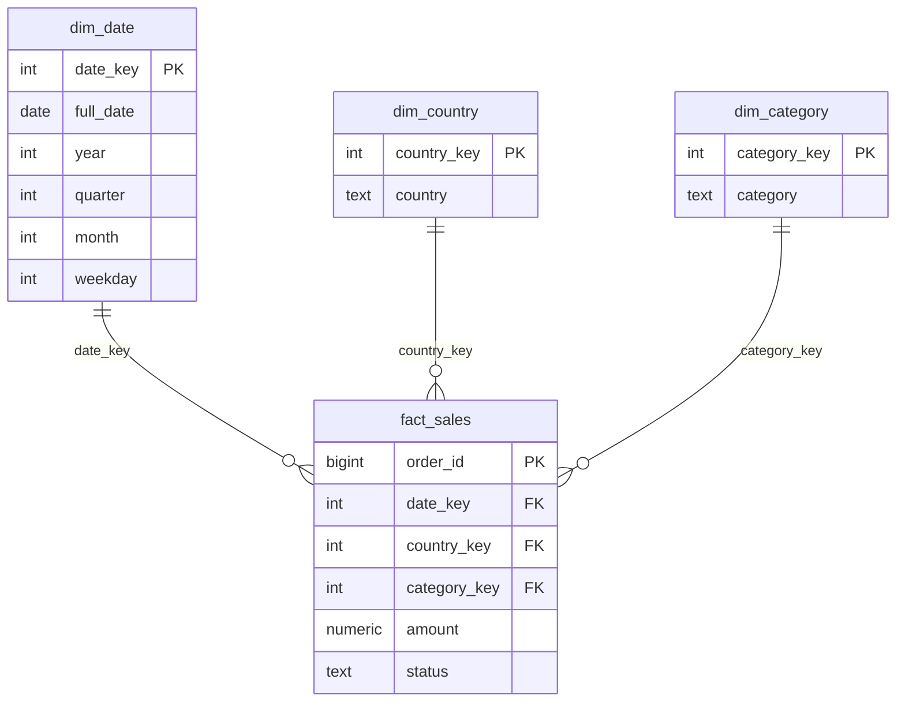

# Architecture

CartPulse keeps analytics away from the store's live databases. Sources are copied into a warehouse on a schedule, checked, and then published for analysts.

## Components

| Component | Role |
| --- | --- |
| MySQL | Source of orders, tuned for fast concurrent writes |
| MongoDB | Source of the product catalog, where products have different attributes |
| Airflow | Schedules the daily pipeline, with retries and run history |
| `cartpulse` package | The pipeline logic, which Airflow and `make pipeline` both run |
| PostgreSQL | The warehouse, with Airflow's metadata in a separate database |
| Spark | Forecasting and search analysis, which write their results to the warehouse |

## Data flow

The daily run has these steps:

1. `prepare_warehouse` creates any missing schema objects.
2. `load_orders`, `load_catalog` and `load_web_traffic` update `staging`, in parallel under Airflow.
3. `build_warehouse` updates the dimensions and the fact table.
4. `check_quality` stops the run if the data fails a check.
5. `refresh_marts` publishes the reports in one transaction.

Spark runs on demand with `make forecast` and `make search-terms`, because it needs its own container and memory.

## Data model

The grain of `fact_sales` is one order. Each dimension connects directly to the fact table, which keeps reports to a few simple joins.

## Design decisions

### Incremental load on `updated_at`

The pipeline reads rows where `updated_at` is at or after the stored watermark. Reading by ID would only find new rows, while `updated_at` also finds corrections and cancellations. MySQL maintains the column, so application code cannot forget it.

### A lookback window with upserts

Each run re-reads the last five minutes. A transaction that commits late can carry an earlier `updated_at` than rows already read, and the window catches it. Re-reading is safe, because the upsert ignores rows whose `updated_at` has not changed.

This guarantee has a limit: a change is read only if it commits within the lookback of its timestamp. The window must therefore be longer than the longest write transaction in the source. A change that falls outside it is not picked up by the regular load, but reconciliation reports it and a run with a longer window repairs it.

### One transaction per load

Rows and the new watermark commit together. If a load fails, both roll back and the next run reads the same window again.

### A quality gate before publication

Checks run after the warehouse build and before the marts refresh. Every fact is compared with its order, including its date, country and category. Amounts, statuses, future dates and the calendar are checked as well. A failure leaves analysts on the last good reports.

Reconciliation compares every order with MySQL on its date, country, category, amount and status. Row counts and totals could hide a changed amount or two changes that cancel out. A source row that changes between the load and the check can raise a false alarm, which clears on the next run.

The catalog count is compared with MongoDB. The log's total lines must equal the requests loaded plus those excluded and rejected, and `etl.load_audit` records all of them.

### A generated calendar

`dim_date` is generated from the order dates. Labels supplied with the sample data disagreed with the calendar on hundreds of days, and generating them removes that class of error. A quality check guards it.

### Materialized views for reports

Reports read stored results, so they stay fast and never compete with the load. Refreshing them in one transaction means analysts see the old reports or the new ones, never a mix.

### A forecast that must beat a baseline

The job trains on all months but the last year, then scores a linear trend and a plain average on that year. The trend is published only if its error is at least 5% lower. A smaller gap is noise, and the simpler model is the safer one. Incomplete months are excluded, so a month in progress does not read as a sales drop.

### Separate images for Airflow and Spark

Both extend supported base images with only what they need. The Spark image is built on a Java 21 runtime and Python 3.12, because the official image ships an older Python and leaves out NumPy.

## Trade-offs

| Decision | Benefit | Cost |
| --- | --- | --- |
| Watermark over change data capture | Simple, with no extra infrastructure | Hard deletes go unseen, and late commits need a repair run |
| Full refresh for catalog and web traffic | Always matches the source | Work grows with source size, not with changes |
| Rebuilding facts from staging | Easy to reason about and to recover | Slower than processing only changed rows at scale |
| Order-by-order reconciliation | No change can hide in a total | Each check reads every order, so large tables would need checksums |
| Airflow `standalone` | One container is enough locally | Components cannot scale separately |
| Spark in local mode | No cluster to run | It uses Spark's API without its scale |
