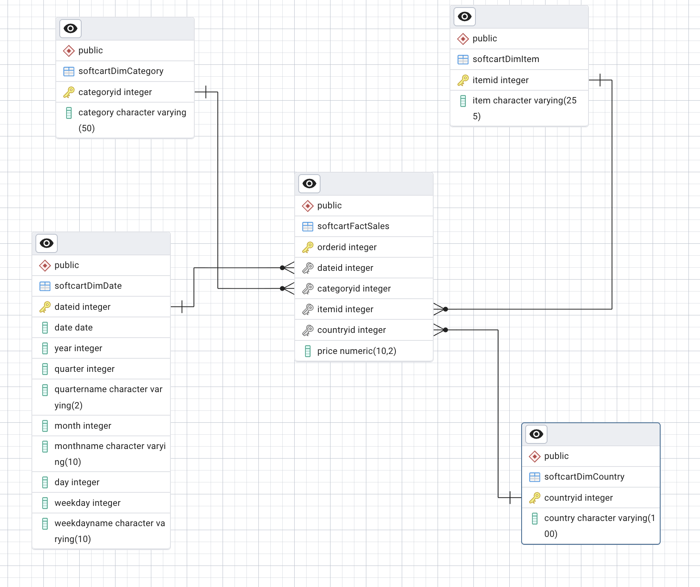

# Module 3: Data Warehouse with PostgreSQL

## Goal

Design a star schema for SoftCart's retail analytics, load 300,000 sales into a warehouse, and answer multi-dimensional reporting questions with aggregation queries.

## Run it

From the repository root:

```bash
make setup               # then replace the placeholder passwords in .env
make up
make load-warehouse
make warehouse-reports
```

`make load-warehouse` is safe to re-run. It leaves the same row counts every time.

To work with the ERD, start pgAdmin with `make admin` and open <http://127.0.0.1:5050>. The warehouse connection is already configured.

## Databases

| Database | Purpose |
| --- | --- |
| `softcart` | Where the ERD was designed. It holds no tables, because drawing a diagram does not create them. |
| `staging` | Holds the schema generated from the ERD. |
| `Test1` | Holds the senior engineer's improved schema, the loaded data and the MQT. |

These names are fixed by the course.

## Design decisions

### Star schema



A central fact table stores measurable events, and dimension tables describe them. Each dimension connects directly to the fact table with a one-to-many relationship, which keeps reports to a small number of simple joins.

| Table | Type | Holds |
| --- | --- | --- |
| `softcartFactSales` | Fact | One row per order, with `price` and dimension keys |
| `softcartDimDate` | Dimension | One row per day, with year, quarter, month and weekday attributes |
| `softcartDimCategory` | Dimension | Product categories |
| `softcartDimItem` | Dimension | Products |
| `softcartDimCountry` | Dimension | Countries |

- **Grain:** one row per order, because each `OrderID` in the sample data has one item.
- **Date dimension:** stores both numbers and names. `month` sorts correctly, and `monthname` reads well in a report.
- **Star, not snowflake:** `softcartDimItem` does not point at `softcartDimCategory`. Fewer joins make reports simpler.
- **`numeric` for money:** binary floats introduce rounding errors.

### Schema review

The senior engineer simplified the design for production. The reporting tables drop the item dimension and store `amount` as an integer. They also have no foreign keys, a common warehouse choice when the load process controls data quality. The loaded data has no orphaned keys.

### MQT as a materialized view

MQT is a Db2 term, and PostgreSQL's equivalent is a materialized view. `total_sales_per_country` stores its result on disk, so reading it does not scan 300,000 rows. It needs `REFRESH MATERIALIZED VIEW` after new data arrives.

### Known issues and trade-offs

- **`DimDate` disagrees with the calendar.** Compared with each row's `date`, `quarter` is wrong on 228 days, month or day on 264 days, and `weekdayname` on 240 days. For example, 2021-12-31 is labeled `Q1`. These days carry 62,394 sales with a wrong quarter. `year` is correct. The data is kept as provided because it is course data, so any report by quarter, month or weekday should be read with care. A production pipeline would derive these attributes from `date`.
- **`character(50)` pads values with spaces.** The provided script uses this type, which widens query output. `character varying` would avoid that.
- **`DimCountry.csv` starts with a byte order mark.** `COPY ... HEADER` discards the first line, so the load is unaffected.
- **ERD foreign keys are `NOT VALID`.** pgAdmin generates them this way, so they are not checked against existing rows. The repository's [02_create_schema.sql](sql/02_create_schema.sql) defines them normally.

## Steps

### Design a data warehouse

- **Tasks 1 to 4:** Design the date, category, item and country dimensions in the pgAdmin ERD tool.
- **Task 5:** Design the `softcartFactSales` fact table.
- **Task 6:** Add one-to-many relationships from each dimension to the fact table.
- **Task 7:** Generate the SQL and create the schema in `staging`, as captured in [01_create_database.sql](sql/01_create_database.sql) and [02_create_schema.sql](sql/02_create_schema.sql).

### Load and query the data

- **Tasks 1 to 4:** Load the four CSV files into `Test1` with [04_load_reporting_data.sql](sql/04_load_reporting_data.sql).
- **Task 5:** Write a `GROUPING SETS` query for country and category totals.
- **Task 6:** Write a `ROLLUP` query for year and country totals.
- **Task 7:** Write a `CUBE` query for average sales by year and country.
- **Task 8:** Create the `total_sales_per_country` MQT with [05_create_mqt.sql](sql/05_create_mqt.sql).

Tasks 5 to 7 are in [06_analytics_queries.sql](sql/06_analytics_queries.sql).

| Feature | Produces | Rows here |
| --- | --- | --- |
| `GROUPING SETS (country, category)` | Only the listed groupings | 61 |
| `ROLLUP (year, country)` | Year and country rows, yearly subtotals, a grand total | 172 |
| `CUBE (year, country)` | Every combination of the two columns | 228 |

A `NULL` in these results means "all values" for that column, so it marks a subtotal.

## Results

| Check | Result |
| --- | --- |
| Rows loaded | `DimDate` 1,096, `DimCategory` 5, `DimCountry` 56, `FactSales` 300,000 |
| Date range | 2019-01-01 to 2021-12-31 |
| Total sales | 1,201,006,258 |
| Average sale | 4,003.35 |
| Top country | Thailand, with 21,848,776 |
| Orphaned keys in `FactSales` | 0 |

## Key learnings

- **Decide the grain first.** It sets which questions a fact table can answer.
- **Dimensions make reports simple.** Pre-computed date attributes replace repeated date logic in every query.
- **Pick aggregation by the shape of the report.** `GROUPING SETS` for chosen totals, `ROLLUP` for hierarchies and `CUBE` for every combination.
- **`NULL` can mean a subtotal.** Reading these results correctly depends on knowing the difference.
- **Materialized views trade freshness for speed.** They suit dashboards that do not need live data.
- **Profile data even when it loads cleanly.** All 1,096 dates loaded without error, and only a comparison against the calendar exposed the wrong quarters.
