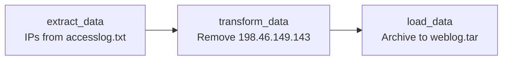

# Module 5: ETL Pipelines with Python and Airflow

## Goal

Move new sales from the OLTP database into the warehouse with an incremental Python ETL, and process the web server log with a daily Apache Airflow pipeline.

## Run it

From the repository root:

```bash
make setup      # then replace the placeholder passwords in .env
make up
make load-etl   # reset the source and target to their initial state
make run-etl    # copy new rows to the warehouse
```

Run `make run-etl` a second time and it moves 0 rows. To start the pipeline:

```bash
make airflow
docker compose exec airflow airflow dags unpause process_web_log
make airflow-password
```

Open <http://127.0.0.1:8088> and sign in as `admin`.

## Part 1: Incremental ETL

### How it works

[automation.py](etl/automation.py) copies only what the warehouse is missing:

1. `get_last_rowid()` finds the highest `rowid` in PostgreSQL. This is the high-water mark.
2. `get_latest_records()` reads MySQL rows with a greater `rowid`.
3. `insert_records()` writes them to PostgreSQL in one transaction.

| | MySQL source | PostgreSQL warehouse |
| --- | --- | --- |
| Before the ETL | 13,836 rows, last `rowid` 13939 | 12,186 rows, last `rowid` 12289 |
| After the ETL | 13,836 rows | 13,836 rows, last `rowid` 13939 |

### Design decisions

- **A high-water mark keeps runs small.** Each run reads only new rows, so the cost follows the daily volume and not the table size.
- **One transaction per load.** A failure rolls back every row, so the warehouse never holds a partial batch.
- **`rowid` is the primary key in both systems.** A duplicate load fails loudly and does not double the data.
- **A separate MySQL service.** The lab's `sales.sql` creates `sales.sales_data` with a different schema from Module 1, so it runs on its own `mysql-etl` service on port 3307. Module 1 stays intact, and the course's names are unchanged.
- **Credentials come from `.env`.** [connections.py](etl/connections.py) keeps connection details in one place, in place of the lab's hardcoded samples.

### Known trade-offs

- **The source has no `price` or timestamp.** The 1,650 migrated rows get `price = 0` and the load time as `timeestamp`, from the column defaults. Revenue reports over this table would undercount them. A real pipeline would need these columns at the source.
- **`rowid` misses updates.** The high-water mark sees new rows only, so changes or deletes in MySQL do not reach the warehouse. Change data capture would cover those cases.
- **`timeestamp` is spelled as the course requires.**
- **The ETL runs on demand.** Airflow does not schedule `automation.py` yet.

## Part 2: Airflow pipeline

[process_web_log.py](dags/process_web_log.py) defines a daily DAG with three Bash tasks:



The scenario text in the lab mentions HTML lines and timestamps, while the graded tasks ask for IP addresses. This pipeline follows the tasks.

- **`catchup=False`** runs only the latest interval, not one run per day since `start_date`.
- **`grep -vxF`** matches the whole line literally, so an IP that merely contains the target value survives.
- **New DAGs start paused**, so nothing runs until it is unpaused on purpose.

Airflow runs in `standalone` mode, with SQLite and the SequentialExecutor. That suits local development. Production would use PostgreSQL and a parallel executor. The `example.com` address in the DAG is a placeholder, and failure emails are off.

## Results

| Check | Result |
| --- | --- |
| Rows moved by the first ETL run | 1,650 |
| Rows moved by the second ETL run | 0 |
| Log lines extracted | 10,000 |
| Lines left after filtering | 9,918 |
| Lines removed | 82 |
| DAG run | `success`, with 3 of 3 tasks complete |

## Key learnings

- **Incremental beats full reload.** A high-water mark is simple and scales with new data only.
- **Test the second run.** A pipeline proves itself when running it again changes nothing.
- **Transactions protect the warehouse.** All or nothing is easier to reason about than a partial load.
- **Know what the source cannot give you.** Missing columns turned into defaults, and that limit has to be stated.
- **Name clashes are design problems.** Isolating the source service kept two course labs working side by side.
- **Airflow adds operations, not logic.** The Bash commands are simple, and the value comes from scheduling, retries and run history.
